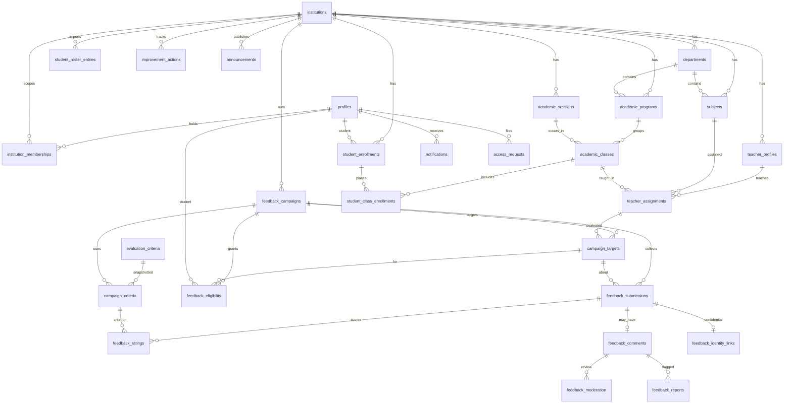

# Phase 1 — Entity Relationship Design

**Status:** Logical ERD for Phase 2. Table names match SQL migrations.

## 1. How to read this

- Boxes are tables.
- `1──<` means one-to-many.
- `institution_id` on child tables, plus composite unique `(id, institution_id)`, is how we stop cross-institution links.

## 2. Identity and institutions

```text
auth.users
    │ 1
    │
    │ 1
profiles ──< institution_memberships >── institutions
                (role, status)               │
                                             ├──< departments
                                             ├──< academic_sessions
                                             ├──< academic_programs
                                             ├──< student_roster_entries
                                             └──< platform is approved/suspended here
```

`institution_memberships.institution_id` is NULL only when `role = super_admin`.

## 3. Academics

```text
institutions
    ├──< departments ──< subjects
    │         └──< academic_programs ──< academic_classes
    ├──< academic_sessions ─────────────┘
    ├──< teacher_profiles ──< teacher_assignments
    │                              ├── subject
    │                              └── academic_class + session
    ├──< student_enrollments ──< student_class_enrollments
    └──< student_roster_entries (pre-account, matched to enrollments)
```

`teacher_assignments` is the teachable unit: one teacher, one subject, one class, one session.

## 4. Campaigns and feedback

```text
evaluation_criteria (global catalog)
        │
        └── copied into campaign_criteria
                    │
feedback_campaigns ─┼──< campaign_targets ──> teacher_assignments
        │           └──< campaign_criteria
        │
        ├──< feedback_eligibility ──> student (profile) + campaign_target
        │
        └──< feedback_submissions
                ├──< feedback_ratings ──> campaign_criteria
                ├──< feedback_comments
                └──  feedback_identity_links (confidential only)
```

## 5. Administration, communication, security

```text
institutions ──< announcements
             ├──< improvement_actions
             ├──< institutional_reports
             └──< notifications (user-scoped, optional institution_id)

feedback_comments ──< feedback_moderation
                  └──< feedback_reports (user-flagged)

access_requests (verification OR unmask)
audit_logs
platform_settings (singleton)
notification_preferences (per user)
```

## 6. Mermaid ERD (logical)



## 7. Table dictionary

### Identity

| Table | Purpose |
| --- | --- |
| `profiles` | App person record, 1:1 with `auth.users` |
| `institutions` | School/college/university; approval status; threshold floor |
| `institution_memberships` | Role of a person at an institution (or Super Admin) |
| `platform_settings` | Singleton: registration flags, default threshold, maintenance |

### Academics

| Table | Purpose |
| --- | --- |
| `departments` | Faculty/department inside one institution |
| `academic_programs` | e.g. BS Computer Science, FSc Pre-Engineering |
| `academic_sessions` | 2025–26 Fall, etc. |
| `academic_classes` | Section/year group inside a program and session |
| `subjects` | Course catalog rows |
| `teacher_profiles` | Teacher employment record at an institution |
| `teacher_assignments` | Who teaches what to which class in which session |
| `student_roster_entries` | Imported list used to verify students |
| `student_enrollments` | Verified student belonging for a session/program |
| `student_class_enrollments` | Which class the student sits in |

### Campaigns and feedback

| Table | Purpose |
| --- | --- |
| `evaluation_criteria` | Global rubric catalog |
| `feedback_campaigns` | Dated collection window, mode, threshold |
| `campaign_criteria` | Frozen rubric for that campaign |
| `campaign_targets` | Which teacher assignments are being evaluated |
| `feedback_eligibility` | Per student per target, one-shot |
| `feedback_submissions` | Header for a completed questionnaire |
| `feedback_ratings` | One value per criterion per submission |
| `feedback_comments` | Optional constructive text |
| `feedback_identity_links` | Confidential-mode mapping |

### Admin / comms / security

| Table | Purpose |
| --- | --- |
| `feedback_moderation` | Moderator decision on a comment |
| `feedback_reports` | User-reported inappropriate content |
| `improvement_actions` | Follow-up work after results |
| `institutional_reports` | Saved/generated report metadata |
| `notifications` | In-app inbox |
| `announcements` | Institution or platform broadcast |
| `notification_preferences` | Per-user toggles |
| `audit_logs` | Privileged action trail |
| `access_requests` | Verification and unmask requests |

## 8. Integrity rules encoded in SQL

- Unique membership `(user, institution, role)` (partial unique for Super Admin).
- Unique roster `(institution, student_number)`.
- Unique enrollment `(user, institution, session)` for students.
- Unique assignment `(teacher_profile, subject, class, session)`.
- Unique eligibility `(campaign, target, student)`.
- Unique rating `(submission, campaign_criterion)`.
- Unique identity link per submission.
- Campaign `ends_at > starts_at`.
- Rating 1–5 or N/A, never both a score and N/A.
- Campaign criteria must belong to the same campaign as the submission.
- Teacher assignment institution must match campaign institution (composite FKs + RPC checks).
